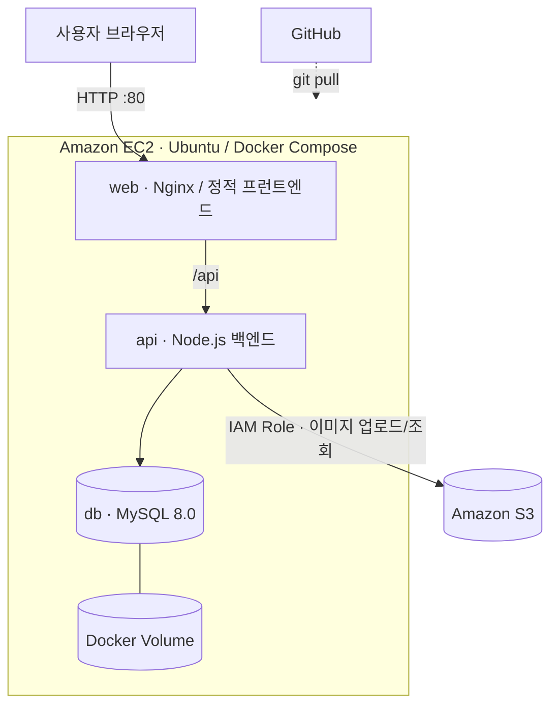

# VS 밸런스 게임

회원가입 없이 A/B 중 하나를 선택하고, 다른 사용자의 투표 결과와 댓글을 확인하는 익명 웹서비스입니다.

## 1. 서비스 소개

| 기능 | 내용 |
| --- | --- |
| VS 주제 생성 | 제목과 두 선택지(A/B)를 등록 |
| 익명 투표 | 브라우저별 식별 쿠키로 동일 주제의 중복 투표 제한 |
| 결과 조회 | 선택지별 득표수·비율 확인 |
| 댓글 | 주제별 익명 댓글 작성·조회 |
| 이미지 첨부 | 선택지 이미지 업로드 및 표시(Amazon S3) |

> 익명 식별 쿠키는 유효기간을 1년으로 설정했였습니다. 쿠키를 삭제하거나 브라우저를 변경하면 재투표가 가능하다는 한계가 있지만, 번거로운 추가 조작이 필요하므로 무분별한 중복 투표·댓글입력을 막을 수 있다 판단하였습니다.

## 2. AWS 구성도



| 구성 | 사용 이유 |
| --- | --- |
| **EC2** | Docker Compose 기반 웹서비스를 AWS 가상 서버에서 실행 |
| **Docker Compose** | `web`·`api`·`db` 컨테이너를 통합 관리 |
| **MySQL + Docker Volume** | 주제·투표·댓글 저장 및 컨테이너 재생성 시 데이터 유지 |
| **S3 + IAM Role** | 실제 이미지 객체 저장 및 액세스 키 없이 접근 권한 부여 |
| **GitHub** | 소스코드 이력 관리 및 EC2 배포 |

**ELB, Auto Scaling 정의**
ELB(Elastic Load Balancing): 여러 서버에 들어오는 사용자 요청을 분산하여 특정 서버에 부하가 집중되는 것을 방지하고 서비스의 가용성을 높이는 AWS 서비스입니다.
Auto Scaling: CPU 사용률 등 설정된 지표와 정책에 따라 서버 수를 자동으로 늘리거나 줄여, 서비스 부하에 대응하고 자원 사용 및 운영 비용을 최적화하는 기술입니다.

**ELB·Auto Scaling 미적용:**
**서비스 규모 및 비용**: 단기간 운영하는 소규모 과제용 웹서비스로, 단일 EC2 인스턴스에서 서비스를 운영하는 것이 적절하다고 판단하였습니다. ELB와 Auto Scaling을 도입하면 추가적인 AWS 리소스와 운영 비용이 발생하므로 현재 규모에서는 효율성이 낮다고 판단하였습니다.
**데이터베이스 구조**: MySQL 데이터를 EC2 내부 Docker Volume에 저장하고 있어, 수평 확장을 위해서는 RDS와 같은 공통 데이터베이스를 구축하거나 DB를 별도 서버로 분리하는 구조 변경이 필요합니다.
**향후 확장 계획**: 실제 서비스 운영으로 가정하며 사용자 수와 트래픽이 증가한다면, 데이터베이스를 공통 저장소로 분리한 뒤 ALB를 통한 요청 분산과 EC2 Auto Scaling을 통한 서버 자동 증설을 검토할 계획입니다. 이를 통해 트래픽 증가에 대응하고 서비스 가용성과 운영 효율성 개선을 기대할 수 있습니다.

## 3. 실행 및 배포

**준비:** Git, Docker Engine·Docker Compose(로컬은 Docker Desktop 가능), 프로젝트 최상위 `.env` 파일.

```bash
git clone https://github.com/hiallu60/vs-game.git
cd vs-game
cp .env.example .env
# .env에 MySQL 비밀번호, COOKIE_SECRET 등 환경변수 입력

docker compose config -q
docker compose up -d --build
docker compose ps
```

- 로컬 접속: **http://localhost** (`WEB_PORT=80` 기준)
- API 상태 확인: `curl http://localhost/api/health`
- 컨테이너: `web`(Nginx, 호스트 80), `api`(Node.js, 내부 3000), `db`(MySQL, 내부 3306)
- `.env`와 개인 키 등 비밀정보는 GitHub에 업로드하지 않습니다.

**AWS EC2 배포:** EC2(Ubuntu)에 Docker·Compose·Git을 설치하고, EC2에 기존 DB 비밀번호가 설정된 `.env` 및 S3 접근용 IAM Role을 준비합니다. EC2에서는 다음 명령어로 배포합니다.

```bash
cd ~/vs-game
git pull --ff-only origin main
docker compose config -q
docker compose up -d --build
docker compose ps
curl http://localhost/api/health
```

- AWS 접속 주소: **`http://13.238.90.86`**
- S3 사용 시: `STORAGE_DRIVER`, S3 버킷·리전 관련 설정을 백엔드 구현에 맞춰 지정합니다.
- 기존 MySQL 볼륨 보호: **`docker compose down -v` 사용 주의** (DB 볼륨 삭제 가능)

## 4. 배포 환경 검증

EC2 퍼블릭 주소에서 실제 화면을 열고 아래 기능을 확인했습니다.

| 기능 | 확인한 정상 동작 | 실패·경계 사례 결과 |
| --- | --- | --- |
| 주제 생성 | 생성 및 MySQL 저장·조회 | 제출 전 기록 필요: 빈 제목·선택지 |
| 익명 투표 | 투표 및 DB 저장 확인 | 제출 전 기록 필요: 동일 브라우저 중복 투표 |
| 결과 조회 | 득표수·비율 표시 | 제출 전 기록 필요: 투표 0건 |
| 댓글 | 작성 및 DB 저장·조회 | 제출 전 기록 필요: 빈 댓글 |
| S3 이미지 | 업로드·DB 객체 키 확인·새로고침 후 표시 | 제출 전 기록 필요: 잘못된 형식·크기 초과 |

컨테이너 `web`·`api`·`db` 실행 상태, API `/api/health`의 `status: ok`, 사이트 외부 접속을 확인했습니다. 

**각 기능의 실패·경계 사례**
| 기능 | 시험 조건 | 실제 결과 |
| 주제 생성	| 제목 미입력	| 등록 차단 및 입력 안내 | 
| 익명 투표	| 동일 주제 중복 | 투표	중복 요청 거부 | 
| 댓글 작성	| 빈 댓글 제출	| 댓글 등록 차단 | 


## 5. 작업 기록 및 자원 관리

- **작업:** 서비스 구현, Docker 이미지 빌드·Compose 실행, MySQL 데이터 확인, EC2 배포, S3·IAM 연동, 기능 검증
- **AI 활용:** ChatGPT를 활용해 코드 작성·설정·명령어 및 오류 해결을 보조받았으며, Docker·AWS 콘솔 작업과 서비스 실행 결과를 직접 확인함
- **운영 확인:** `docker compose ps`, `docker compose logs --tail=50`, `docker stats --no-stream`
- **제출:** [GitHub 저장소](https://github.com/hiallu60/vs-game), 실제 EC2 접속 주소, 작업 버전(커밋), 기능별 시험 결과 제시
- **검사 후:** EC2·S3 등 불필요한 AWS 자원을 정리하고 GitHub 저장소와 README 보존
