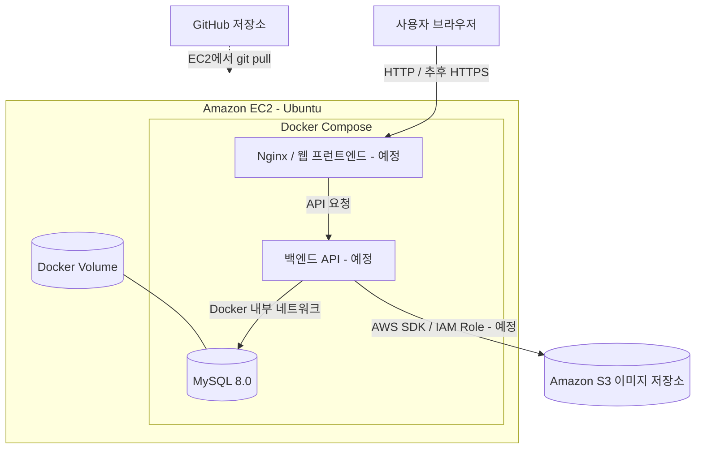

# VS 밸런스 게임 웹서비스 (임시임. 최종 제출 전에 반드시 수정)

> **작성 상태: 개발 중 / 제출 전 검토 필수**  
> 이 문서는 AWS 프로젝트 과제 요구사항을 기준으로 작성한 **임시 README**입니다. 실제 구현·배포·시험을 완료한 항목만 `[완료]`로 변경하고, 배포 주소와 증빙을 추가해야 합니다.

## 1. 서비스 소개

### 1.1 프로젝트 개요

**VS 밸런스 게임**은 사용자가 두 선택지(A/B)로 구성된 질문을 등록하고, 다른 사용자가 회원가입 없이 익명으로 선택하여 전체 투표 비율과 댓글을 확인하는 웹서비스입니다.

**사용 시나리오**

1. 사용자가 메인 화면에서 VS 주제 목록을 확인합니다.
2. 새 주제를 만들 때 제목과 두 선택지를 작성합니다. 선택지 이미지는 선택적으로 첨부할 수 있습니다.
3. 다른 사용자가 주제에 접속해 A 또는 B에 익명 투표합니다.
4. 투표 후 각 선택지의 득표수·비율과 전체 투표 수를 확인합니다.
5. 주제 하단에서 익명 댓글을 작성하거나 다른 댓글을 조회합니다.

예시: **A. 재입대하고 20억 받기 vs B. 그냥 10억 받기**

### 1.2 핵심 사용자 기능

| 번호 | 기능 | 사용자 입력 | 확인 가능한 결과 | 개발 상태 |
|---|---|---|---|---|
| 1 | VS 주제 생성 | 제목, 선택지 A/B | 메인 목록에 신규 주제 표시 | 예정 |
| 2 | 익명 투표 | A 또는 B 선택 | 투표 저장 및 중복 투표 제한 | 예정 |
| 3 | 투표 결과 조회 | 투표 완료 후 결과 요청 | 선택지별 득표수·퍼센트·총 투표수 표시 | 예정 |
| 4 | 댓글 작성·조회 | 댓글 내용 | 댓글 저장 및 주제별 목록 출력 | 예정 |
| 5 | 이미지 첨부 | 선택지별 이미지(선택) | 이미지 업로드 후 주제 화면에 표시 | 예정 |

**범위 제한:** 회원가입/로그인, 다중 팀 관리, 인기순·최신순 정렬, 주제 수정·삭제, 댓글 삭제 및 관리자 기능은 이번 필수 구현 범위에서 제외합니다. 댓글 삭제 등은 향후 확장 기능으로 검토합니다.

**익명 투표 주의:** 브라우저별 익명 식별 토큰을 이용한 중복 투표 제한을 계획하고 있으나, 브라우저 데이터 삭제·기기 변경에 대해 엄밀한 1인 1표를 보장하지는 않습니다.

## 2. AWS 구성도 및 서비스 선정 이유

### 2.1 배포 아키텍처



> **현재 구현 상태:** EC2 생성, SSH 연결, Docker Engine·Compose 설치, MySQL 컨테이너 시작 및 `init.sql` 초기화 로그 확인. Nginx·백엔드·프런트엔드·S3는 아직 연동 전입니다. 위 구성도는 **최종 목표 구조**입니다.

| 구성 요소 | 선정 이유 | 구축 상태 |
|---|---|---|
| Amazon EC2 | 실제 웹서비스를 외부에 배포하는 가상 서버 | 완료 |
| Docker Compose | 웹·API·MySQL 컨테이너를 일관된 설정으로 실행·관리 | 설치 및 MySQL 구성 완료 |
| MySQL 8.0 | 주제·투표·댓글 데이터 관계형 저장 | 초기화 로그 확인, 기능 검증 진행 중 |
| Docker Volume | DB 컨테이너 재생성 시에도 데이터 보존 | 설정 완료 |
| Amazon S3 | 첨부 이미지 파일 저장, DB에는 객체 키만 관리 | 예정 |
| IAM Role | EC2 애플리케이션에 S3 접근 권한 부여(장기 액세스 키 파일 사용 회피) | 예정 |
| GitHub | 소스코드 버전 관리 및 배포 파일 공유 | 연결 진행 중 |

### 2.2 데이터 저장 방식

- **MySQL:** `topics`, `votes`, `comments` 테이블에 주제·선택·댓글을 저장합니다.
- **S3(구현 예정):** 선택지 A/B에 첨부한 실제 이미지 파일을 저장합니다. MySQL `topics.image_a_key`, `topics.image_b_key`에는 S3 객체 키를 저장합니다.
- **Docker Volume:** `mysql_data`에 MySQL 데이터 디렉터리를 보존합니다. 컨테이너를 재생성해도 볼륨을 삭제하지 않으면 데이터가 유지됩니다.
- **네트워크:** MySQL의 3306 포트는 외부에 공개하지 않고 내부 Docker 네트워크에서만 접근하도록 구성합니다.

### 2.3 ELB 및 Auto Scaling 적용 검토 — (임시임. 최종 제출 전에 반드시 수정)

이번 프로젝트는 단기간 운영하는 소규모 과제용 서비스이므로 **ELB와 Auto Scaling을 적용하지 않는 방향**을 우선 선택하였습니다.

**ELB(Elastic Load Balancing):** 여러 애플리케이션 서버 사이에 요청을 분산할 수 있습니다. 그러나 현재 배포 목표는 단일 EC2에서 Docker Compose로 웹·API·MySQL을 실행하는 구조이므로, 로드 밸런서의 추가 비용과 구성이 필요 이상으로 커질 수 있습니다.

**EC2 Auto Scaling:** 부하 및 정책에 따라 인스턴스 수를 자동으로 늘리거나 줄일 수 있습니다. 하지만 현재 MySQL은 단일 EC2의 Docker 볼륨에 저장되므로 EC2를 그대로 복제하면 서버마다 데이터가 달라질 위험이 있습니다. 확장을 도입한다면 DB를 공유 가능한 독립 서비스(예: RDS 또는 별도 공용 DB 서버)로 분리하고, 신규 EC2의 자동 초기화 및 공통 데이터 접근 구조를 마련해야 합니다. **RDS는 ELB의 필수 조건이 아니라 공통 DB 구성 방법 중 하나입니다.**

**향후 확장 방안:** 공통 DB 분리 → Application Load Balancer와 대상 그룹 구성 → EC2 Auto Scaling Group 및 시작 템플릿 구성 → 헬스체크·스케일링 정책 검증.

> **최종 제출 전 보완:** 실제 동시 요청 시험 및 CPU·메모리 사용량, 가용성 요구, AWS 예상 비용을 기록해 미적용 판단의 객관적인 근거를 제시해야 합니다.

## 3. 실행 방법 — 로컬 Docker Compose

### 3.1 사전 요구사항

- Git
- Docker Engine + Docker Compose 플러그인 또는 Windows Docker Desktop
- 프로젝트 저장소: `https://github.com/hiallu60/vs-game`

```bash
git clone https://github.com/hiallu60/vs-game.git
cd vs-game
```

> 기존 로컬 작업 폴더가 있으면 새로 클론하지 않고 해당 폴더에서 `git pull`을 사용합니다.

### 3.2 환경변수 준비

Git으로 공유하지 않는 `.env` 파일을 프로젝트 최상위 경로에 만듭니다. 아래 값은 **예시**이므로 실제로는 서로 다른 안전한 비밀번호를 사용해야 합니다.

```dotenv
MYSQL_ROOT_PASSWORD=<강력한_관리자_비밀번호>
MYSQL_DATABASE=vs_game
MYSQL_USER=vs_game_app
MYSQL_PASSWORD=<강력한_앱_계정_비밀번호>
```

- `.env`는 GitHub에 업로드하지 않습니다.
- 향후 이미지 기능 구현 시 AWS 권한은 EC2의 IAM Role을 사용하고, 로컬에서는 적절한 개발용 자격 증명 방식을 사용합니다.
- `.env.example` 파일은 추후 비밀값 없이 추가할 예정입니다.

### 3.3 MySQL 실행과 검증

현재 Compose 파일은 **MySQL 서비스만 구성된 상태**입니다.

```bash
docker compose config -q
docker compose up -d
docker compose ps
docker compose logs --tail=30 db
```

첫 실행에서 빈 데이터 볼륨을 초기화할 때 `database/init.sql`이 실행되어 세 개의 테이블이 생성되도록 설정되어 있습니다.

```bash
docker compose exec db sh -c 'mysql -u "$MYSQL_USER" -p"$MYSQL_PASSWORD" "$MYSQL_DATABASE" -e "SHOW TABLES;"'
```

기대 테이블: `topics`, `votes`, `comments`.

> **중요:** 이미 데이터가 있는 볼륨에 대해서는 `init.sql`을 수정해도 자동으로 재적용되지 않습니다. 추후 스키마 변경은 별도 SQL 마이그레이션으로 관리해야 합니다. `docker compose down -v`는 DB 볼륨을 삭제할 수 있으니 데이터 보존이 필요하면 사용하지 마세요.

### 3.4 전체 웹서비스 로컬 실행 (구현 예정)

프런트엔드·백엔드·Nginx 서비스를 `compose.yaml`에 추가한 뒤 다음과 같이 실행할 계획입니다.

```bash
docker compose up -d --build
```

**최종 제출 전 추가할 사항:** 로컬 접속 URL/포트, 실제 화면 캡처, 환경변수 목록, 컨테이너별 시작 및 종료 방법, 오류 시 로그 확인법.

## 4. AWS 배포 방법

### 4.1 EC2 준비

1. AWS 서울 리전(`ap-northeast-2`)에 Ubuntu EC2 인스턴스를 생성합니다.
2. 보안 그룹에서 SSH(22)는 관리자 IP에만 허용하고 HTTP(80), 필요 시 HTTPS(443)를 공개합니다.
3. `.pem` 키로 SSH 접속합니다.
4. Docker Engine, Docker Compose, Git을 설치합니다.
5. EC2의 IAM Role을 S3 최소 권한 정책과 연결합니다(이미지 기능 구현 시).

```bash
ssh -i "<키_파일_경로>" ubuntu@<EC2_PUBLIC_IP>
```

### 4.2 GitHub 소스 배포

**Windows 개발 PC:** 코드 수정과 로컬 검증 이후 다음 명령어로 GitHub에 반영합니다.

```bash
git add .
git commit -m "Update service"
git push origin main
```

**EC2:** 프로젝트가 이미 GitHub의 `main` 브랜치를 추적하도록 설정된 경우 다음 명령어로 최신 소스를 가져옵니다.

```bash
cd ~/vs-game
git pull --ff-only origin main
docker compose up -d --build
docker compose ps
```

> **주의:** EC2에 기존 `compose.yaml`과 DB 볼륨이 있으므로 처음 Git 저장소에 연결할 때 기존 파일을 백업하고 중복 파일 충돌을 해결해야 합니다. `.env`는 EC2에 별도로 보관하고 Git에 넣지 않습니다.

### 4.3 배포 확인 및 운영

- `docker compose ps`에서 컨테이너 실행 상태 확인
- `docker compose logs --tail=100 <서비스명>`으로 오류 확인
- 최종적으로 **실제 EC2 배포 주소**에서 5개 기능 직접 시연
- 보안 그룹에 MySQL(3306) 및 내부 API 포트를 불필요하게 공개하지 않음
- 공개 운영 시 HTTPS, 이미지 검증·접근 정책, 익명 댓글 악용 방지 등을 점검

**배포 URL:** 미기재 — 실제 웹서비스 공개 후 기입할 것

## 5. 기능별 테스트 계획 및 결과 (임시)

과제 평가에 맞춰 **기능별 정상 사례 최소 1건과 실패 또는 경계 사례 최소 1건**을 기록합니다. 아래 결과는 아직 실행되지 않은 계획이므로 성공으로 표시하지 않습니다.

| 기능 | 정상 사례 | 실패·경계 사례 | 실제 테스트 결과 |
|---|---|---|---|
| 주제 생성 | 제목과 A/B를 입력해 주제 생성 | 제목 또는 선택지 공백 제출 거부 | 미실시 |
| 익명 투표 | A 또는 B 투표 저장 | 같은 익명 토큰으로 같은 주제 중복 투표 거부 | 미실시 |
| 투표 결과 조회 | 득표수·퍼센트·합계 표시 | 투표 0건일 때 0으로 나누지 않도록 처리 | 미실시 |
| 댓글 작성·조회 | 댓글 저장 및 목록 반영 | 빈 댓글 입력 거부 | 미실시 |
| 이미지 첨부 | 허용된 형식의 선택지 이미지 업로드·표시 | 허용되지 않는 파일 형식 또는 용량 초과 거부 | 미실시 |

**실행 증빙 추가 예정:** 기능별 입력 화면, 정상 결과, 오류 처리 화면, AWS 배포 주소, 로그 또는 테스트 출력.

## 6. 현재 작업 현황

| 작업 | 상태 |
|---|---|
| EC2 생성 및 SSH 접속 | 완료 |
| Docker Engine / Compose 설치 | 완료 |
| `.env` 및 MySQL Compose 서비스 구성 | 완료 |
| MySQL DB·계정 생성, `init.sql` 실행 로그 확인 | 완료 |
| `topics`·`votes`·`comments` 실데이터 검증 | 최종 확인 필요 |
| GitHub 저장소 생성 및 로컬 파일 업로드 | 완료 |
| EC2와 GitHub 저장소 연결 | 진행 중 |
| 프런트엔드·백엔드 API | 미구현 |
| S3 업로드 및 표시 | 미구현 |
| 로컬 전체 서비스 실행·AWS 주소 시연 | 미실시 |

## 7. 최종 제출 전 체크리스트

- [ ] 5개 사용자 기능 실제 구현 및 AWS 주소에서 동작 확인
- [ ] 각 기능의 성공·실패 또는 경계 사례 테스트 결과 첨부
- [ ] 로컬 Docker Compose 전체 서비스 실행 검증
- [ ] 최종 AWS 구성도와 실제 사용 서비스 목록 일치 확인
- [ ] S3 이미지 업로드·조회 및 파일 검증 구현 결과 첨부
- [ ] 실제 배포 URL 및 접근 방법 기입
- [ ] 실제 실행·빌드·배포 명령어 검증 후 수정
- [ ] ELB·Auto Scaling 적용 판단에 부하·비용 근거 보완
- [ ] `.env`, 개인 키, 토큰 등 비밀정보 커밋 여부 재확인
- [ ] 문서 제목의 **'(임시임. 최종 제출 전에 반드시 수정)'** 문구 삭제 또는 최종 버전으로 교체
