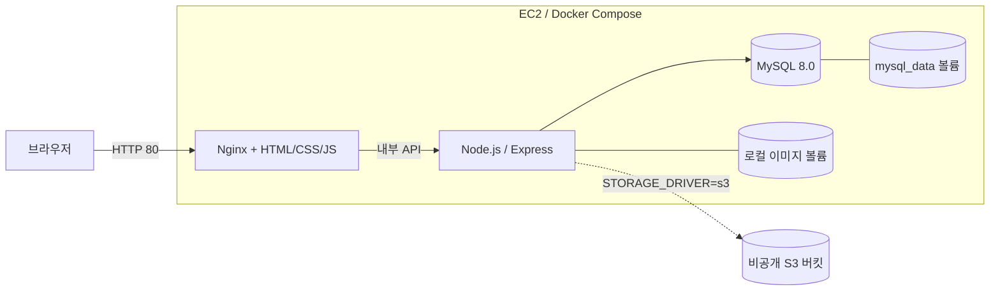

# VS 밸런스 게임

회원가입 없이 두 선택지 중 하나에 투표하고 결과와 의견을 나누는 소규모 AWS 과제용 웹서비스입니다. 기능을 늘리기보다 **세 가지 사용자 흐름과 요청량에 맞는 운영**에 집중합니다.

1. **주제 생성·조회:** 제목과 A/B 선택지 입력, 선택적으로 이미지 첨부
2. **익명 투표·결과:** 브라우저별 중복 투표 제한, 득표수·비율 표시
3. **댓글 작성·조회:** 주제별 익명 댓글

로그인, 검색, 인기순 정렬, 수정·삭제, 관리자 기능은 구현 범위에서 제외했습니다. 목록은 최근 등록 순으로 12개, 댓글은 20개씩 불러옵니다. 브라우저 쿠키 삭제·다른 기기 사용까지 엄격한 1인 1표를 보장하지는 않습니다.

## 구성



외부 공개 포트는 웹 포트 하나입니다. API 3000·DB 3306은 호스트에 공개하지 않습니다. 기존 `topics`, `votes`, `comments` 스키마를 그대로 사용하며 마이그레이션은 필요하지 않습니다. 기존 Compose 프로젝트 이름과 경로를 유지해야 기존 DB 볼륨을 계속 사용합니다.

## 실행

Docker Engine + Compose가 필요합니다. Windows에서는 Docker Desktop을 사용할 수 있습니다.

```bash
# 처음 실행할 때만. 기존 .env가 있으면 덮어쓰지 마세요.
cp .env.example .env
```

기존 DB의 네 가지 `MYSQL_*` 값은 그대로 유지하고 `.env.example`을 참고해 새 항목을 추가합니다. `COOKIE_SECRET`은 32자 이상의 임의 문자열로 설정하고 재시작해도 유지하세요. 바꾸면 기존 투표 쿠키가 무효화됩니다. Node.js가 있다면 다음으로 값을 만들 수 있습니다.

```bash
node -e "console.log(require('crypto').randomBytes(32).toString('hex'))"
docker compose config -q
docker compose up -d --build
docker compose ps
```

기본 접속 주소: **http://localhost** / EC2에서는 **http://EC2_PUBLIC_IP**. 80번 포트가 사용 중이면 `WEB_PORT=8080`으로 설정합니다. 현재 코드는 저장소에 구현된 상태이며 **이번 작업에서 실제 EC2 웹 배포는 실행하지 않았습니다.**

| 환경변수 | 설명 |
|---|---|
| MYSQL_ROOT_PASSWORD | DB 초기 관리자 비밀번호 |
| MYSQL_DATABASE / MYSQL_USER / MYSQL_PASSWORD | 기존 DB 이름·앱 계정·비밀번호 |
| COOKIE_SECRET | 32자 이상 서명 비밀값, 운영 중 고정 |
| COOKIE_SECURE | HTTP는 false, HTTPS 구성 후 true |
| WEB_PORT | 기본 80 |
| STORAGE_DRIVER | local 또는 s3, 기본 local |
| AWS_REGION | 실제 S3 버킷 리전 |
| S3_BUCKET | s3 모드의 비공개 버킷 이름 |

MySQL 이미지의 초기 환경변수는 빈 볼륨에서만 DB·계정을 생성합니다. 기존 볼륨의 비밀번호는 `.env` 값만 바꿔도 변경되지 않습니다. `database/init.sql`도 빈 볼륨에서만 자동 실행됩니다. **`docker compose down -v`는 저장 데이터를 삭제하므로 사용하지 마세요.**

## 이미지 저장

기본 `local` 모드는 `uploads` 볼륨에 저장합니다. 파일 확장자가 아닌 실제 이미지 내용을 검사하고, 최대 5MB·2,500만 화소의 JPG/PNG/WebP만 받아 최대 1400px WebP로 다시 인코딩합니다. 주제 생성 중 오류가 나면 이미 저장된 파일을 정리합니다. DB에는 이미지 키만 저장합니다.

AWS에서는 비공개 S3 버킷을 만들고 EC2 IAM Role에 아래 권한을 부여한 뒤 `STORAGE_DRIVER=s3`, `S3_BUCKET`, `AWS_REGION`을 설정합니다. 액세스 키를 소스에 넣지 않습니다. 조회에는 1시간 유효한 서명 URL을 사용하며, 만료된 이미지는 화면을 새로 불러오면 갱신됩니다. 브라우저가 S3에 직접 업로드하지 않으므로 별도 업로드 CORS 설정은 필요하지 않습니다.

```json
{
  "Version": "2012-10-17",
  "Statement": [{
    "Effect": "Allow",
    "Action": ["s3:PutObject", "s3:GetObject", "s3:DeleteObject"],
    "Resource": "arn:aws:s3:::YOUR_BUCKET/images/*"
  }]
}
```

EC2 컨테이너에서 인스턴스 역할을 사용하려면 IMDSv2 접근이 가능해야 합니다. Docker 네트워크 환경에서는 EC2 메타데이터 응답 hop limit 2가 필요할 수 있습니다. 저장 모드를 바꾸면 기존 키의 저장소도 달라지므로 기존 이미지가 있다면 먼저 파일을 이전해야 합니다. S3 실제 연결은 아직 검증하지 않았습니다.

## API

| 메서드·경로 | 역할 |
|---|---|
| GET /api/health | API와 DB 연결 확인 |
| GET /api/topics?before=ID | 주제 목록, next 커서 반환 |
| POST /api/topics | multipart: title, option_a, option_b, 선택 image_a/image_b |
| GET /api/topics/:id | 주제와 현재 브라우저의 투표 여부 |
| POST /api/topics/:id/votes | JSON: choice = A 또는 B |
| GET /api/topics/:id/results | 투표한 브라우저만 결과 조회 |
| GET /api/topics/:id/comments?before=ID | 댓글 목록 |
| POST /api/topics/:id/comments | JSON: content, 1~1000자 |

익명 토큰은 HttpOnly·SameSite 쿠키에 서명해 저장하고 DB에는 SHA-256 해시를 저장합니다. DB의 `(topic_id, voter_token_hash)` 유일 제약으로 동시 중복 투표도 차단합니다. SQL 값은 바인딩하며 화면 출력은 HTML 이스케이프합니다. 주제 제목은 200자, 선택지는 각 255자까지입니다.

## 요청량과 운영

단일 EC2·단일 API·단일 DB를 전제로 합니다. API 연결 풀은 최대 10개이며 IP당 API 분당 300회, 쓰기 분당 30회로 제한합니다. 제한은 단일 API 프로세스 메모리에 보관되어 재시작하면 초기화됩니다. Nginx는 전달 IP를 재설정하며 API는 Nginx 한 단계를 신뢰합니다. API 포트를 외부에 직접 공개하지 마세요.

Compose는 DB 512MB / API 384MB / 웹 64MB 메모리 상한, CPU 상한과 컨테이너당 로그 10MB × 3개를 설정합니다. 이 수치는 성능 보장값이 아닌 초기 운영 한도입니다. **현재 EC2는 RAM 약 908MB, 가용 메모리 약 196MB, 스왑 없음**으로 확인되어 전체 스택 빌드·운영 여유가 적습니다. 2GB 이상 RAM을 출발점으로 삼고 실제 측정 후 조정하세요. 인스턴스 크기나 AWS 설정은 이번 작업에서 변경하지 않았습니다.

```bash
docker compose logs --tail=100 api web db
docker stats --no-stream
curl http://localhost/api/health
# Node.js 24가 있는 곳에서: 동시 요청 5개, 총 50개의 목록 조회
node backend/load-check.js
# 다른 주소는 BASE_URL 환경변수로 지정
```

요청 실패 수, 평균·p95 응답시간, CPU·메모리를 기록해 과제의 요청량 근거로 사용하세요. 현재 부하 시험 결과는 미측정입니다. 사용자가 증가하면 먼저 쿼리·자원 사용량을 확인하고 자원을 조정합니다. ELB·Auto Scaling은 현재 적용하지 않습니다. 여러 EC2로 확장하려면 공통 DB·S3·공통 제한 저장소를 준비한 후 검토합니다.

EC2 배포 시 SSH는 관리자 IP만 허용하고 웹 포트만 공개합니다. HTTPS는 별도 도메인·인증서 설정이 필요하며 이번 구현에는 포함되지 않습니다. DB 백업과 복구 시험도 실제 운영 전에 수행해야 합니다.

## 검증 결과

```bash
cd backend
npm ci
npm test
npm audit --omit=dev
```

이번 구현에서 자동 테스트 5개 통과, 운영 의존성 보안 검사 취약점 0건을 확인했습니다.

| 구분 | 확인 내용 | 결과 |
|---|---|---|
| 주제 | 생성·조회, 공백·최대 길이 초과, 잘못된 ID·없는 주제 | HTTP 테스트 통과 |
| 투표·결과 | 결과 사전 조회 차단, 잘못된 선택, 재투표 거부, 브라우저 분리, 100%·50% 결과 | HTTP 테스트 통과 |
| 댓글 | 작성·조회, 공백·1000자 초과 거부, HTML 문자열 보존 | HTTP 테스트 통과 |
| 요청 보호 | 다른 사이트 요청·5MB 초과 첨부 거부 | HTTP 테스트 통과 |
| 이미지 | 실제 PNG 디코딩·WebP 변환·로컬 저장·삭제, 위조 이미지 거부 | 실제 파일 테스트 통과 |

HTTP 테스트는 DB 대역을 사용합니다. JavaScript 문법 검사와 EC2의 Docker Compose 설정 문법 검사도 통과했습니다(컨테이너는 기동하지 않음). **실제 MySQL 유일 제약·전체 Docker Compose 기동·브라우저 화면 시연·S3·EC2 웹 배포·부하 시험은 아직 검증하지 않았습니다.** 개발 PC에 Docker가 설치되어 있지 않아 전체 컨테이너 검증을 실행하지 못했습니다. DB 데이터와 EC2 기존 구성은 변경하지 않았습니다.

## 전체 파일 구조

`.env`, 설치 폴더 `node_modules`, 기존 `.venv`, `.git` 등은 소스 구조에서 제외합니다.

```text
vs-game/
├── .env.example           # 비밀값 없는 환경 설정 예시
├── .gitignore             # 비밀값·키·설치 파일 제외
├── compose.yaml           # 웹·API·DB 연결, 볼륨, 헬스체크, 자원 상한
├── README.md              # 실행·배포·운영·검증 안내
├── database/
│   ├── init.sql           # 기존 3개 테이블과 투표 유일 제약
│   └── test.sql           # 기존 수동 DB 확인용 샘플 INSERT/SELECT
├── backend/
│   ├── package.json       # 서버 의존성과 실행·테스트 명령
│   ├── package-lock.json  # 의존성 버전 고정
│   ├── Dockerfile         # 일반 사용자로 API 컨테이너 실행
│   ├── .dockerignore      # 빌드에서 설치 파일·업로드·테스트 제외
│   ├── server.js          # MySQL 연결 풀과 서버 시작·종료
│   ├── app.js             # 주제·투표·결과·댓글 API, 검증·요청 제한
│   ├── storage.js         # 이미지 검증·변환, 로컬/S3 저장·조회
│   ├── app.test.js        # API·쿠키·이미지 자동 테스트
│   └── load-check.js      # 소규모 읽기 요청 부하 측정
└── frontend/
    ├── Dockerfile         # 정적 화면을 Nginx 이미지에 포함
    ├── nginx.conf         # 정적 파일 제공과 API·이미지 프록시
    ├── index.html         # 화면 골격과 주제 작성 폼
    ├── style.css          # 반응형 화면 스타일
    └── app.js             # 목록·상세·투표·댓글 API 연결
```

최종 제출 전: 실제 배포 URL, 정상·실패 시연 화면, S3 증빙, 부하 시험 수치, 백업 확인 결과를 추가하세요.

구현 참고: [Express 오류 처리](https://expressjs.com/en/5x/guide/error-handling/), [AWS SDK S3 예제](https://docs.aws.amazon.com/sdk-for-javascript/v3/developer-guide/javascript_s3_code_examples.html).
